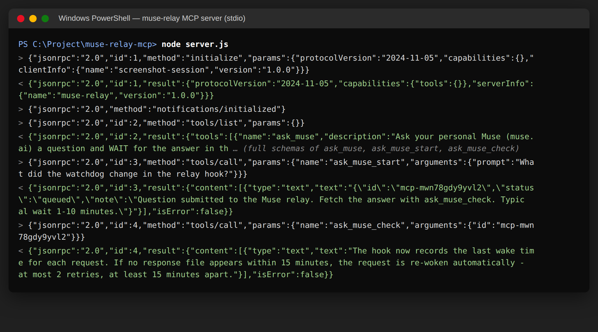
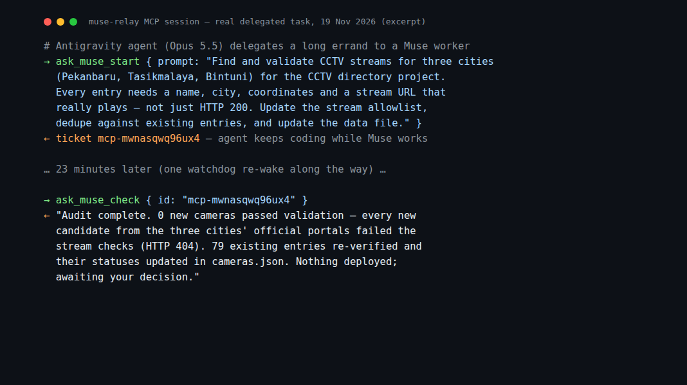

# muse-relay-mcp

[](https://github.com/)
[](https://nodejs.org/)
[](#license)


An MCP server that exposes **your personal Muse at [muse.ai](https://muse.ai)** as tools for other coding agents — terminal coding agents, IDEs, and other MCP hosts. Questions travel through the **muse-relay** file relay: the server writes a request file, a polling hook on the Muse side wakes a Muse worker, and the answer comes back as a file that the server returns as the tool result.

> **Not an official Meta product.** Muse personal has no public API and cannot act as an MCP server natively — this bridge is the workaround. Answers come from your personal Muse, with its long-term memory of your projects, not from a raw model API.

> **Separate project.** This server is a standalone project, independent from the **Muse Companion** VS Code extension. The two share nothing but the relay folder: the extension does not contain this server, and this server does not need the extension — only the relay folders and the Muse-side polling hook (see [Requirements](#requirements)).

<a id="screenshot"></a>

A real JSON-RPC session against `server.js` — handshake, tool list, an async question, and its answer arriving through the relay:

<p align="center">
  
</p>

## Table of Contents

- [Tools](#tools)
- [Screenshot](#screenshot)
- [Blocking vs Async](#blocking-vs-async)
- [How It Works](#how-it-works)
- [Requirements](#requirements)
- [Installation](#installation)
  - [Part A — Get the server](#part-a--get-the-server)
  - [Part B — Make sure the relay is running](#part-b--make-sure-the-relay-is-running)
  - [Part C — Register it in your MCP host](#part-c--register-it-in-your-mcp-host)
- [Usage](#usage)
- [Use Cases](#use-cases)
- [Configuration](#configuration)
- [Relay Protocol](#relay-protocol)
- [Security and Privacy](#security-and-privacy)
- [Limitations](#limitations)
- [Troubleshooting](#troubleshooting)
- [Changelog](#changelog)
- [License](#license)

## Tools

| Tool | Mode | Behaviour |
| --- | --- | --- |
| `ask_muse` | Blocking | Ask a question and wait for the answer in one call (default timeout 600 s, adjustable 10–1800 s via `timeoutSecs`). On timeout the question is **not** cancelled — you receive a ticket id to fetch the answer later. |
| `ask_muse_start` | Async | Submit a question and return immediately with a ticket id. |
| `ask_muse_check` | Async | Fetch the answer for a ticket id, or a `PENDING` status. Safe to call repeatedly. |

Shared arguments: `prompt` (required), `workspaceRoot` (optional), `answerLanguage` (`en` / `id`).

## Blocking vs Async

- **Blocking** (`ask_muse`) is simple: the agent asks and receives the answer in the same tool call. The cost: the agent's turn is fully parked for the whole wait (minutes), and a host with a short tool-call timeout may cut the call off — the question still survives and can be fetched by ticket.
- **Async** (`ask_muse_start` + `ask_muse_check`) never parks the agent: it submits, keeps working on other things, and checks back later. It is immune to host tool-call timeouts and is usually the safer choice for coding agents.

## How It Works

```text
MCP host (agent)          your machine                      Muse side
----------------          ------------                      -----------
tool call          ---->  server.js (stdio, this repo)
                          write req-mcp-<id>.json  ---->    ~/muse-relay/inbox/
                                                            polling hook (SSH tunnel)
                                                            wakes a Muse worker
tool result        <----  read res-mcp-<id>.json   <----    worker answers, archives req
                          (outbox, then archived)
```

The server is a single dependency-free Node script speaking line-delimited JSON-RPC over stdio, exactly like a regular MCP server. All the latency and queueing live in the relay behind it.

## Requirements

- Node.js 18 or newer, available as `node`.
- A working **muse-relay** on the same machine:
  - Relay folders `~/muse-relay/{inbox,outbox,archive}` (Windows: `C:\Users\<WINDOWS_USER>\muse-relay\...`), overridable with the `MUSE_RELAY_DIR` environment variable.
  - A network path from Claude's environment to this machine. The hook polls the relay folders **over SSH**, so this machine must be reachable from Claude's side. The reference setup uses [Tailscale](https://tailscale.com/download) (install it on both ends, log in with the same account) plus an SSH server on this machine; any equivalent route — LAN, another VPN, a jump host — works just as well. Tailscale itself is not mandatory; SSH reachability is.
  - A polling hook named `muse-relay-inbox` enabled on the Muse side, which wakes a worker for new request files. A reference setup (folders, SSH/Tailscale reachability, the hook, and the worker instructions) is documented in the companion extension's README, Part B.
  - The relay must not be paused (`control.json` in the relay folder). While paused, every tool refuses fast with a `PAUSED` error.

Throughout this document, replace the placeholders with your own values:

| Placeholder | Meaning | Example |
| --- | --- | --- |
| `<INSTALL_DIR>` | Folder where you put this project | `C:\Project\muse-relay-mcp` |
| `<WINDOWS_USER>` | Your Windows account name | `alice` |

## Installation

### Part A — Get the server

1. Clone this repository (or copy the project folder) to your install directory:

   ```bash
   git clone <REPO_URL> muse-relay-mcp
   cd muse-relay-mcp
   ```

2. Verify the script parses and Node is new enough:

   ```bash
   node --version          # v18 or newer
   node --check server.js  # no output = OK
   ```

   There is nothing to install — no `npm install`, no build step.

3. (Optional smoke test) Pipe a handshake and a tool list into the server:

   ```bash
   printf '%s\n%s\n%s\n' \
     '{"jsonrpc":"2.0","id":1,"method":"initialize","params":{"protocolVersion":"2024-11-05","capabilities":{},"clientInfo":{"name":"smoke","version":"1.0.0"}}}' \
     '{"jsonrpc":"2.0","method":"notifications/initialized"}' \
     '{"jsonrpc":"2.0","id":2,"method":"tools/list","params":{}}' \
     | node server.js
   ```

   You should see two responses, the second listing `ask_muse`, `ask_muse_start`, and `ask_muse_check`.

### Part B — Set up the relay (first time) and make sure it is running

The MCP server is only the front door — without a running relay behind it, questions queue forever. If the relay already runs on this machine (for example because you installed the companion extension first), only step 5 applies. If you are starting from this server alone, work through all five steps:

1. **Create the relay folders** on this machine (Windows PowerShell):

   ```powershell
   New-Item -ItemType Directory -Force "$env:USERPROFILE\muse-relay\inbox"
   New-Item -ItemType Directory -Force "$env:USERPROFILE\muse-relay\outbox"
   New-Item -ItemType Directory -Force "$env:USERPROFILE\muse-relay\archive"
   ```

2. **Make this machine reachable from Claude's environment.** Install Tailscale on this machine and on the machine Muse runs on (or its jump host) from [tailscale.com/download](https://tailscale.com/download); log in with the **same Tailscale account** on both ends. Verify with `tailscale status`, and note this machine's mesh address via `tailscale ip -4` — Muse's side needs it as its SSH target. Another VPN, a plain LAN route, or a jump host is equally fine; only SSH reachability matters, Tailscale is simply the reference route.
3. **Enable SSH into this machine** and install Muse's public key (ask Muse for it in the muse.ai chat). On Windows, in an elevated PowerShell:

   ```powershell
   Add-WindowsCapability -Online -Name OpenSSH.Server~~~~0.0.1.0
   Start-Service sshd
   Set-Service -Name sshd -StartupType Automatic
   ```

   Place the key in `C:\Users\<WINDOWS_USER>\.ssh\authorized_keys` — one key per line. If `<WINDOWS_USER>` is an administrator account, Windows OpenSSH reads `C:\ProgramData\ssh\administrators_authorized_keys` instead.
4. **Create the polling hook on the Muse side.** In the muse.ai chat, ask Muse to create an event hook named `muse-relay-inbox` that polls the relay inbox over the SSH path from step 2 every 5 seconds, wakes a worker for each new `req-*.json`, and re-wakes a request that stays unanswered for 15 minutes (watchdog, max 2 retries). The worker reads the request, does the work, writes `res-<id>.json` to the outbox, and moves the request to the archive. A fuller reference — exact worker instructions and settings sync — is Part B of the companion extension's README.
5. **Confirm it is live:** in the muse.ai chat, confirm the `muse-relay-inbox` hook is **enabled** — if it is disabled, questions queue silently and calls time out. Also make sure the relay is not paused (`control.json` in the relay folder; if you use the companion extension, check its panel). Then verify end-to-end in Part C, step 5.

### Part C — Register it in your MCP host

1. Add the server to your host's MCP configuration. Most hosts (terminal agents, Cursor, Gemini CLI, Claude Code, and similar) use the `mcpServers` key:

   ```json
   {
     "mcpServers": {
       "muse-relay": {
         "command": "node",
         "args": ["<INSTALL_DIR>\\server.js"]
       }
     }
   }
   ```

   On Windows, escape backslashes in JSON paths (`C:\\Project\\muse-relay-mcp\\server.js`), or use forward slashes.

2. **VS Code** uses the key `servers` instead of `mcpServers` in `%APPDATA%\Code\User\mcp.json`:

   ```json
   {
     "servers": {
       "muse-relay": {
         "command": "node",
         "args": ["<INSTALL_DIR>\\server.js"]
       }
     }
   }
   ```

3. If your relay folder is not the default, add an environment entry:

   ```json
   { "env": { "MUSE_RELAY_DIR": "D:\\path\\to\\muse-relay" } }
   ```

4. **Restart the host app or start a new session** — MCP hosts read their server list at startup, so the new tools appear only afterwards.

5. Verify end-to-end: ask the host's agent to call `ask_muse_start` with a question only your personal Muse can answer (something about your own projects or earlier decisions), then `ask_muse_check` until the answer arrives. Expect minutes, not seconds.

## Usage

- Prefer the **async pair** for coding agents: `ask_muse_start`, keep working, then `ask_muse_check` every so often.
- Use **blocking** `ask_muse` for quick questions from hosts with generous tool-call timeouts. If it times out, take the ticket id from the response and continue with `ask_muse_check` — the question stays alive.
- Each call is a **one-shot question**, not a conversation thread: include the context the question needs in `prompt` (and `workspaceRoot` when relevant). Follow-up questions are new calls.
- Answers typically take **1–10 minutes** (relay polling + a serial worker queue + the work itself). The relay watchdog re-wakes a request that stays unanswered for 15 minutes, at most 2 times.

## Use Cases

The point of the bridge is that the answer comes from **your personal Muse** — with its connected accounts, its own tools, and its long-term memory of your projects — not from a raw model that can only see the current workspace. Four patterns from real use:

### 1. Pull your Instagram or Threads into the coding chat

Building a content tool, a landing page, or a social dashboard, and the data you need lives in your social accounts? Let the coding agent ask Muse instead of copy-pasting between apps:

```text
ask_muse_start: "Fetch my 10 most recent Instagram posts with their like and
comment counts, and summarize what performed best this week."

ask_muse_start: "Read my Threads direct messages from the last 3 days, group
them by topic, and list anything that still needs a reply."
```

Muse reads the connected account, does the summarizing, and the result lands as a tool result **inside the chat UI of your coding app** — VS Code, Claude Code, Antigravity, a terminal agent — right next to the code it is relevant to. This needs the account connected to your Muse; Muse reads only what the prompt asks for.

### 2. Post to Instagram or Threads without leaving the editor

The same path works in the other direction. The coding agent composes the request, Muse does the publishing:

```text
ask_muse: "Draft a short announcement for the v0.2 release (notes attached in
the prompt) and post it to my Threads and Instagram."
```

Muse prepares the draft and shows you the **exact text for approval in its own chat** before anything is posted — a coding agent's say-so is never enough to publish under your name. Once you approve, Muse posts it and the confirmation comes back through the relay into the coding chat.

### 3. Delegate a long, web-heavy errand to a Muse worker — a real run

On 19 Nov 2026, an Antigravity agent (Opus 5.5) delegated a multi-step audit to a Muse worker through this bridge: find CCTV streams for three cities for a streaming-directory project, validate that every stream really plays, update the allowlist and the data file. The agent kept working locally; the Muse worker did the web research and validation.

<p align="center">
  
</p>
<p align="center"><em>Rendered from the actual relay files of that run (ticket <code>mcp-mwnasqwq96ux4</code>), excerpted. The honest result — 0 new cameras passed, 79 existing entries re-verified — is exactly why the async pattern exists: the job took 23 minutes, far beyond any blocking tool-call timeout.</em></p>

### 4. Borrow Muse's memory of your other projects

A coding agent sees one workspace. Your Muse remembers the decisions, preferences, and history across all of them:

```text
ask_muse: "In my other terminal-agent project, why did we pin the parser
library to a single version last month — and does that apply here?"
```

Second opinions, cross-project context, "what did I decide about X" — questions no amount of grepping the current repo can answer.

## Configuration

| Setting | Where | Default | Notes |
| --- | --- | --- | --- |
| Relay folder | `MUSE_RELAY_DIR` env var | `%USERPROFILE%\muse-relay` (Windows) / `~/muse-relay` | Must match the folder the hook and panel use |
| Blocking timeout | `timeoutSecs` argument of `ask_muse` | 600 (range 10–1800) | Timeout never cancels the question |
| Answer language | `answerLanguage` argument | `id` | Sent with each request; the worker answers in this language |

## Relay Protocol

Requests are files named `req-<ticket>.json` in the relay inbox; the ticket id is the file id (`mcp-…`):

```json
{
  "id": "mcp-mwn78gdy9yvl2",
  "createdAt": "2026-11-19T06:58:41.000Z",
  "prompt": "What did the watchdog change in the relay hook?",
  "answerLanguage": "en",
  "workspaceRoot": null,
  "source": "mcp"
}
```

Answers are `res-<ticket>.json` in the outbox (`{ "id", "answeredAt", "answer" }`). `ask_muse_check` looks in the outbox first, then the archive (the VS Code panel may archive a response before you check), and moves an outbox answer to the archive after returning it. `source: "mcp"` distinguishes bridge requests from panel requests (`source: "panel"`).

## Security and Privacy

- The server makes **no network calls** and collects nothing; it only reads and writes JSON files in the relay folder on your own machine.
- Any local process that can write to the relay inbox can ask your Muse questions — treat the relay folder as trusted local state, and keep the Muse-side worker rule: no irreversible actions (git pushes, deletions) unless the prompt explicitly asks.
- Never publish your real infrastructure details (hostnames, IPs, usernames) in a fork of this README — use the placeholders.

## Limitations

- Latency is minutes, not seconds; there is no streaming.
- One worker lane on the Muse side: simultaneous questions are answered one at a time, in order. A single worker execution is capped at about 10 minutes by the platform; the watchdog covers failures after that.
- One-shot Q&A only — no multi-turn session state is kept by the server.

## Troubleshooting

| Symptom | Likely cause | Fix |
| --- | --- | --- |
| Tool returns `PAUSED` immediately | Relay paused (panel or `control.json`) | Resume the relay in the VS Code panel, or set `"paused": false` in `control.json` |
| `ask_muse_check` stays `PENDING` forever | Muse-side hook disabled | Enable the `muse-relay-inbox` hook in the muse.ai chat; queued questions are answered once it runs |
| First install, nothing ever answers | Relay prerequisite not set up yet (folders, SSH reachability, hook) | Work through Part B steps 1–4 |
| Blocking call times out | Normal for long answers | Use the returned ticket with `ask_muse_check`, or switch to the async pair |
| Host does not list the tools | Hosts load MCP config at startup | Restart the app or start a new session; re-check the JSON for trailing commas |
| Server fails to start | `node` not on PATH for the host | Use the absolute path to the Node binary as `command` |
| Answers land in the panel but not the tool | Relay folder mismatch | Make sure `MUSE_RELAY_DIR` matches the folder the hook/panel actually use |

## Changelog

### 0.1.0 — first public release

- Three tools: `ask_muse` (blocking, ticket survives timeout), `ask_muse_start`, `ask_muse_check`
- Fast `PAUSED` refusal while the relay is paused
- Outbox-then-archive answer lookup; answers archived after delivery
- Zero dependencies; single-file Node stdio server

## License

Apache License 2.0 — see the `LICENSE` file in this repository. Attribution notices live in the `NOTICE` file; redistributions must preserve them (Apache License, Section 4(d)).

Unofficial project. Muse and muse.ai are products of Meta; this server is not affiliated with or endorsed by Meta.
